# DocConnect — Healthcare Service Provider Platform

<p align="center">
  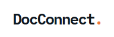
</p>

<p align="center">
  <strong>A Modern, Unified Digital Healthcare Ecosystem Connecting Patients, Doctors, Assistants, and Medical Centers.</strong>
</p>

<p align="center">
  
  
  
  
  
  
  
  
</p>

---

## 📑 Table of Contents

- [Overview](#-overview)
- [Key Features](#-key-features)
- [System Architecture & Visual Diagrams (Mermaid)](#-system-architecture--visual-diagrams)
  - [1. Use Case Diagram](#1-use-case-diagram)
  - [2. User Workflow Diagram](#2-user-workflow-diagram)
  - [3. Sequence Diagram (Consultation & Approval Flow)](#3-sequence-diagram-consultation--approval-flow)
  - [4. Class Diagram](#4-class-diagram)
  - [5. Entity-Relationship (ER) Diagram](#5-entity-relationship-er-diagram)
  - [6. Deployment Architecture Diagram](#6-deployment-architecture-diagram)
- [Application Screenshots](#-application-screenshots)
- [Technology Stack](#-technology-stack)
- [Project Directory Structure](#-project-directory-structure)
- [Installation & Getting Started](#-installation--getting-started)
  - [Prerequisites](#prerequisites)
  - [Backend Setup](#backend-setup)
  - [Frontend Setup](#frontend-setup)
  - [Demo Accounts](#demo-accounts)
- [API Endpoints Reference](#-api-endpoints-reference)
- [License](#-license)

---

## 🌟 Overview

**DocConnect** is an enterprise-grade healthcare service platform designed to streamline clinical workflows, patient appointments, consultations, and digital prescription issuance. 

It implements a 4-role hierarchy (**Patient**, **Doctor**, **Assistant**, and **Admin**):
- **Patients** can find certified doctors, review clinic locations, request consultation access, book in-person or virtual appointments, securely message healthcare professionals, and receive digital QR-coded prescriptions.
- **Doctors** can manage their schedules, triage patient consultation requests, conduct consultations, manage appointments, and issue tamper-verifiable digital prescriptions.
- **Assistants** support doctors and medical centers by screening consultation requests, coordinating schedules, and validating prescription barcodes.
- **Admins** manage hospital centers, doctor assignments, and overall system telemetry.

---

## 🚀 Key Features

- **Role-Based Access Control (RBAC):** Distinct dashboards and security scopes for Patients, Doctors, Clinic Assistants, and System Administrators.
- **Doctor Discovery & Geo-Location:** Search medical specialists by specialization, consultation fees, and medical center locations.
- **Access Approval Workflow:** Flexible consultation request system where doctors can delegate request approvals to clinical assistants or manage them directly.
- **Real-Time Consultations:** WebSocket-based real-time chat powered by Django Channels and Daphne ASGI.
- **Appointment Scheduling:** Support for both in-person clinic visits and virtual appointments with status tracking (`pending`, `approved`, `completed`, `cancelled`).
- **Encrypted QR Digital Prescriptions:** Doctors generate prescriptions with diagnoses, medicines, dosages, and instructions; the system renders automated QR barcodes validated via computer vision (`OpenCV` and `PyZbar`).
- **Automated In-App Notifications:** Real-time feedback when appointments are confirmed, access requests are updated, or prescriptions are validated.

---

## 📐 System Architecture & Visual Diagrams

The following system design and workflow diagrams are rendered visually directly from our architectural specifications in [`logic/`](logic/).

### 1. Use Case Diagram
Highlights user interactions and permission boundaries across Admin, Doctor, Patient, and Assistant roles:

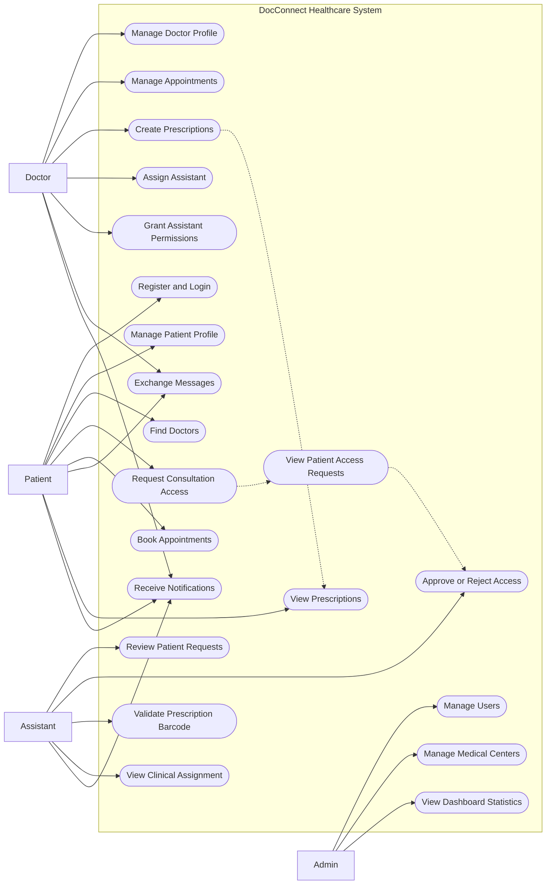

---

### 2. User Workflow Diagram
End-to-end user journey from authentication and role routing to appointment booking, live messaging, and prescription verification:

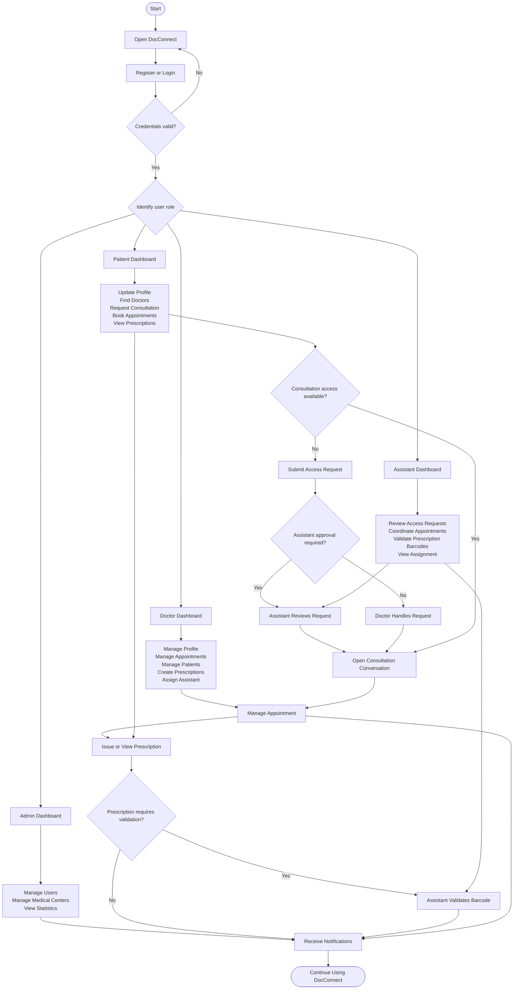

---

### 3. Sequence Diagram (Consultation & Approval Flow)
The lifecycle of patient requests, assistant triage routing, automated notification dispatches, and conversation enablement:

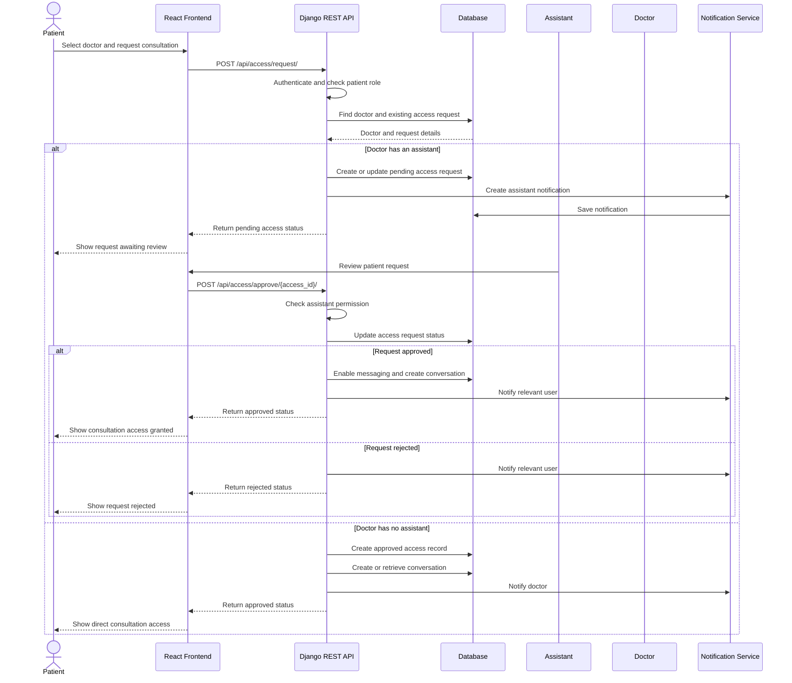

---

### 4. Class Diagram
Object-oriented domain structure depicting model classes, relations, methods, and access control associations:

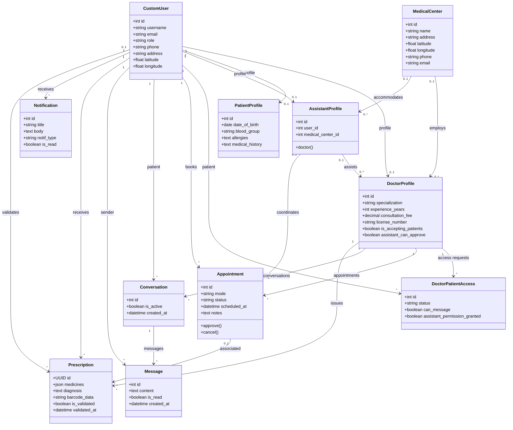

---

### 5. Entity-Relationship (ER) Diagram
Detailed relational schema of the database including foreign keys, cardinality, and data types:

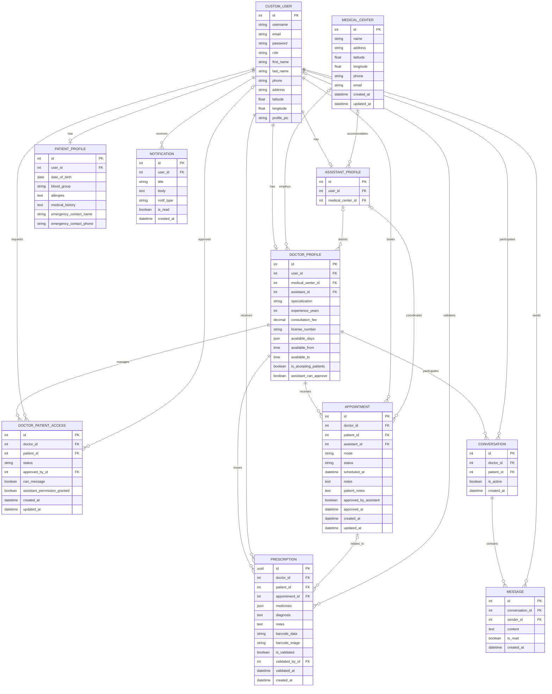

---

### 6. Deployment Architecture Diagram
Complete multi-tier client, ASGI server, WebSocket consumer, and storage topology:

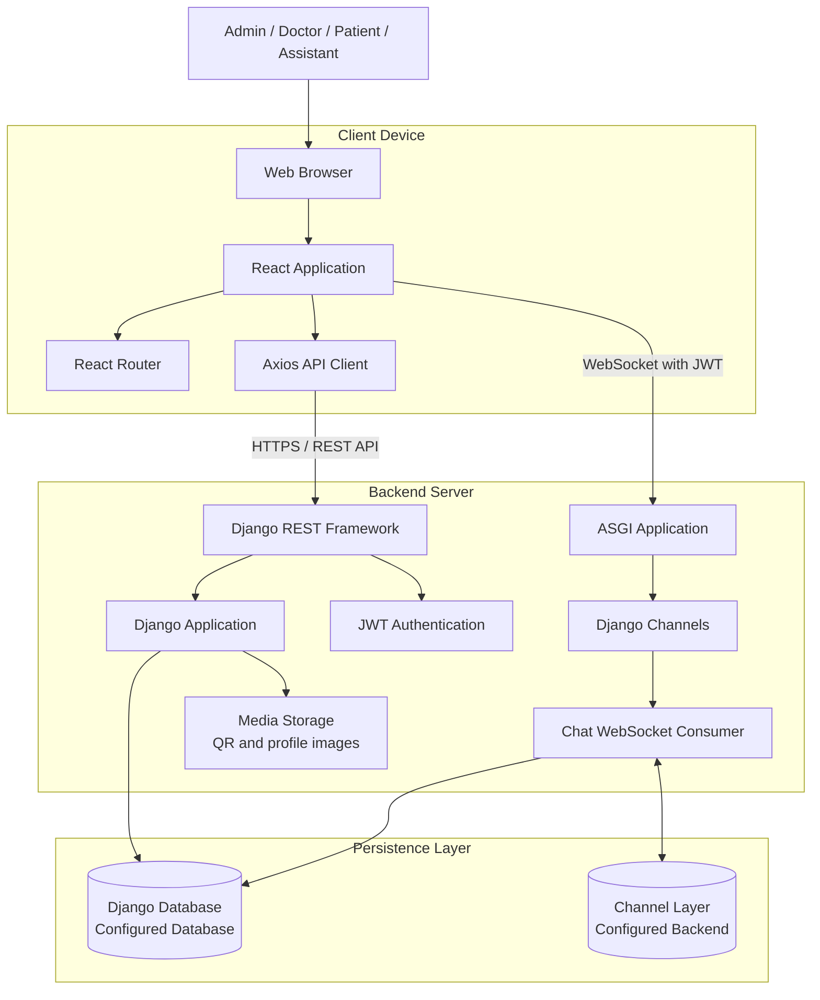

---

## 📸 Application Screenshots

### Authentication & Onboarding
Seamless onboarding with role selection, clean validation, and persistent JWT authentication:

| Login Portal | Registration Portal |
| :---: | :---: |
| 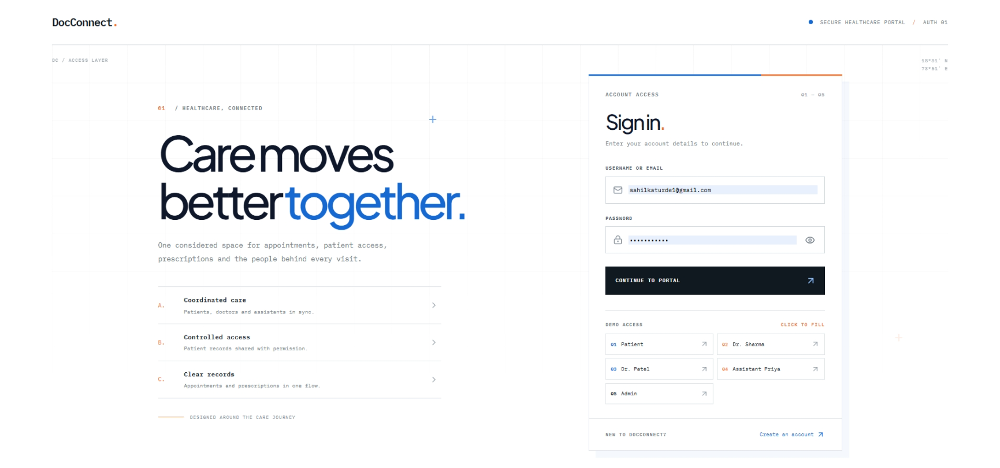 | 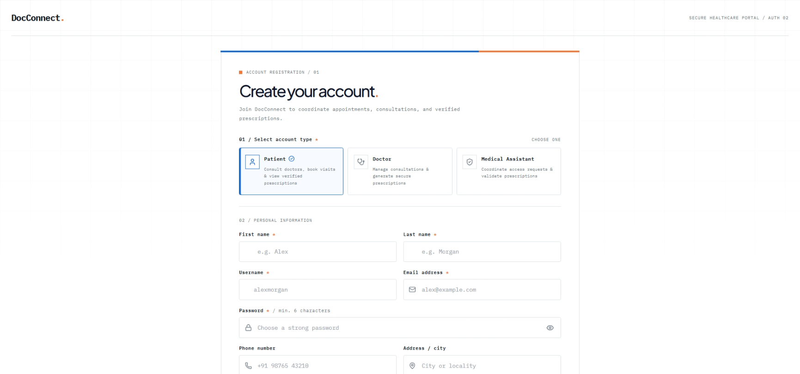 |

---

### Doctor Workspace & Clinical Dashboard
Comprehensive dashboard with appointment summaries, pending approvals, quick actions, and revenue metrics:

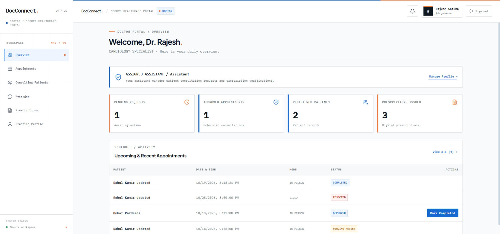

---

### Appointment Management
Manage appointment calendars, consultation modes (In-person / Online), patient medical notes, and status workflows:

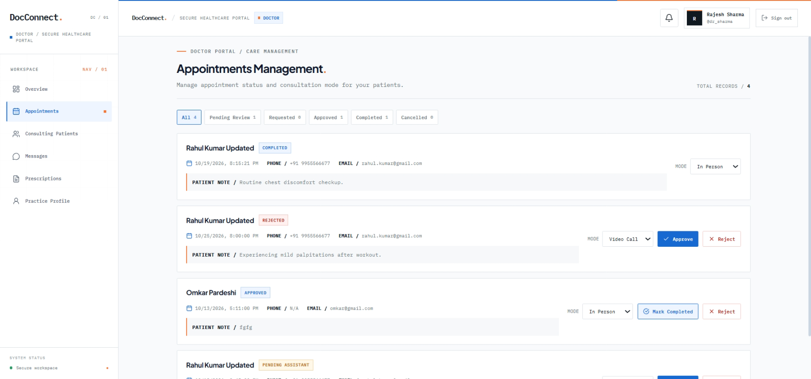

---

### Secure Digital Prescription with QR Code
Automated digital prescription generation featuring medicine regimen tables, dosages, diagnostic notes, and automated QR verification code:

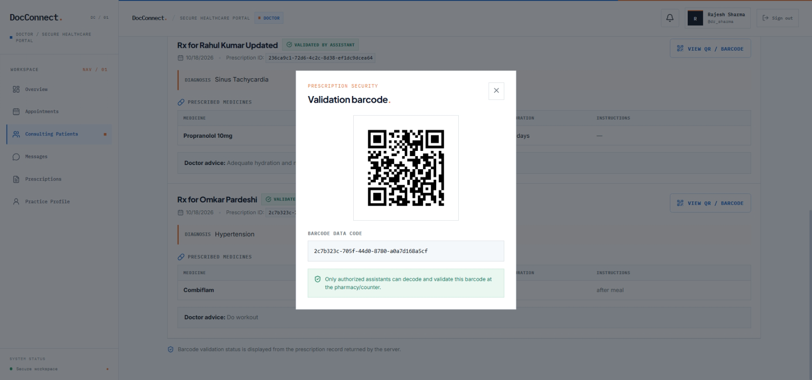

---

## 🛠️ Technology Stack

### Frontend
- **Framework:** [React 19](https://react.dev/)
- **Bundler & Build Tool:** [Vite 8](https://vitejs.dev/)
- **Routing:** [React Router 7](https://reactrouter.com/)
- **HTTP Client:** [Axios](https://axios-http.com/)
- **Icons & UI Feedback:** [Lucide React](https://lucide.dev/), [React Hot Toast](https://react-hot-toast.com/)
- **Token Management:** `jwt-decode`

### Backend
- **Core Framework:** [Django 6.1+](https://www.djangoproject.com/)
- **API Engine:** [Django REST Framework (DRF)](https://www.django-rest-framework.org/)
- **Real-Time Communication:** [Django Channels 4](https://channels.readthedocs.io/) & [Daphne ASGI](https://github.com/django/daphne)
- **Authentication:** [Django REST Framework SimpleJWT](https://django-rest-framework-simplejwt.readthedocs.io/)
- **Barcode & QR Vision:** [OpenCV](https://opencv.org/), [PyZbar](https://pypi.org/project/pyzbar/), [qrcode](https://pypi.org/project/qrcode/)
- **Database:** SQLite (default for development) / PostgreSQL ready

---

## 📁 Project Directory Structure

```plaintext
DocConnect_HealthCare_Service_Provider/
├── backend/                        # Django backend application
│   ├── api/                        # Core API app (models, views, serializers, urls)
│   │   ├── admin.py
│   │   ├── consumers.py            # WebSocket consumer for real-time messaging
│   │   ├── models.py               # Database schemas & custom user models
│   │   ├── routing.py              # WebSocket routing definition
│   │   ├── serializers.py          # DRF model serializers
│   │   ├── urls.py                 # REST API routes
│   │   └── views.py                # Business logic, QR generation & verification
│   ├── core/                       # Django project configuration & ASGI/WSGI
│   │   ├── asgi.py                 # ASGI configuration for HTTP + WebSockets
│   │   ├── settings.py
│   │   └── urls.py
│   ├── media/                      # Uploaded media & generated QR codes
│   ├── manage.py
│   ├── pyproject.toml              # Python dependencies & metadata
│   └── seed_demo_data.py           # Database seeder with sample doctors, patients & rx
├── frontend/                       # React + Vite frontend application
│   ├── src/
│   │   ├── api/                    # Axios clients & API request helpers
│   │   ├── components/             # Reusable UI components & layouts
│   │   ├── context/                # Authentication & state context providers
│   │   ├── pages/                  # Route views (Login, Register, Dashboards, Appointments)
│   │   ├── App.jsx
│   │   └── main.jsx
│   ├── index.html
│   ├── package.json                # Frontend dependencies & scripts
│   └── vite.config.js
├── logic/                          # Architecture & design specifications (.mermaid)
│   ├── class_digram.mermaid        # Domain model class diagram
│   ├── deployment_digram.mermaid   # Infrastructure & deployment topology
│   ├── ER_digram.mermaid           # Entity-relationship data schema
│   ├── swqunces_digram.mermaid     # Consultation sequence diagram
│   ├── usecase_digram.mermaid      # System use cases diagram
│   └── user_worfollow.mermaid      # User lifecycle flowchart
├── screenshot/                     # Project screenshots & visual branding
│   ├── DocConnect_logo.png
│   ├── DoctorAppoiments.png
│   ├── DoctorDashboard.png
│   ├── LoginPage.png
│   ├── QRPRescription.png
│   └── SignupPage.png
└── README.md                       # Main documentation & architecture guide
```

---

## ⚡ Installation & Getting Started

### Prerequisites
- **Node.js** (v18.0 or higher) & `npm`
- **Python** (v3.12 or higher)
- **Git**

---

### Backend Setup

1. **Navigate to the backend directory:**
   ```bash
   cd backend
   ```

2. **Create and activate a virtual environment:**
   ```bash
   # On Windows (PowerShell)
   python -m venv .venv
   .venv\Scripts\Activate.ps1

   # On Linux/macOS
   python3 -m venv .venv
   source .venv/bin/activate
   ```

3. **Install dependencies:**
   ```bash
   pip install django djangorestframework djangorestframework-simplejwt django-cors-headers channels daphne qrcode pillow opencv-python pyzbar cryptography
   ```

4. **Apply database migrations:**
   ```bash
   python manage.py makemigrations
   python manage.py migrate
   ```

5. **Seed demo data (Creates sample doctors, assistant, patient, appointments & prescriptions):**
   ```bash
   python seed_demo_data.py
   ```

6. **Start the ASGI development server:**
   ```bash
   python manage.py runserver
   ```
   > Backend server will be accessible at: `http://127.0.0.1:8000/`

---

### Frontend Setup

1. **Navigate to the frontend directory:**
   ```bash
   cd ../frontend
   ```

2. **Install node dependencies:**
   ```bash
   npm install
   ```

3. **Launch the Vite development server:**
   ```bash
   npm run dev
   ```
   > Frontend application will be live at: `http://localhost:5173/`

---

### 🔑 Demo Accounts

Use the pre-seeded demo accounts to test various roles immediately:

| Role | Username | Password | Notes |
| :--- | :--- | :--- | :--- |
| **Admin** | `admin` | `admin123` | Full superuser access to admin dashboard & center settings |
| **Doctor** | `dr_sharma` | `doctor123` | Cardiologist at City Health Hospital (Assisted by Priya) |
| **Doctor** | `dr_patel` | `doctor123` | General Physician at Metro Care Clinic (Direct access) |
| **Assistant**| `assistant_priya` | `assistant123` | Assistant assigned to Dr. Sharma & City Health Hospital |
| **Patient** | `patient_rahul` | `patient123` | Patient Rahul Kumar with active consultations & prescriptions |

---

## 📡 API Endpoints Reference

| Category | Method | Endpoint | Description |
| :--- | :--- | :--- | :--- |
| **Auth** | `POST` | `/api/auth/register/` | Register a new user (`patient`, `doctor`, `assistant`) |
| **Auth** | `POST` | `/api/auth/login/` | Obtain JWT token pair (`access`, `refresh`) |
| **Auth** | `GET` | `/api/auth/profile/` | Retrieve authenticated user profile |
| **Doctors** | `GET` | `/api/doctors/` | Search & list active doctors with medical center info |
| **Access** | `POST` | `/api/access/request/` | Submit consultation access request to a doctor |
| **Access** | `POST` | `/api/access/approve/<id>/` | Doctor/Assistant approve or reject access request |
| **Appointments** | `GET`, `POST`| `/api/appointments/` | Retrieve or schedule patient appointments |
| **Appointments** | `PATCH` | `/api/appointments/<id>/` | Update appointment status (`approved`, `completed`, etc.) |
| **Prescriptions**| `GET`, `POST`| `/api/prescriptions/` | Create or fetch digital prescriptions with QR code |
| **Prescriptions**| `POST` | `/api/prescriptions/validate/` | Validate scanned barcode or upload QR code image |
| **WebSocket** | `WS` | `/ws/chat/<conv_id>/?token=<jwt>`| Real-time consultation chat stream |

---

## 📄 License

This project is open-source and available under the [MIT License](LICENSE).
